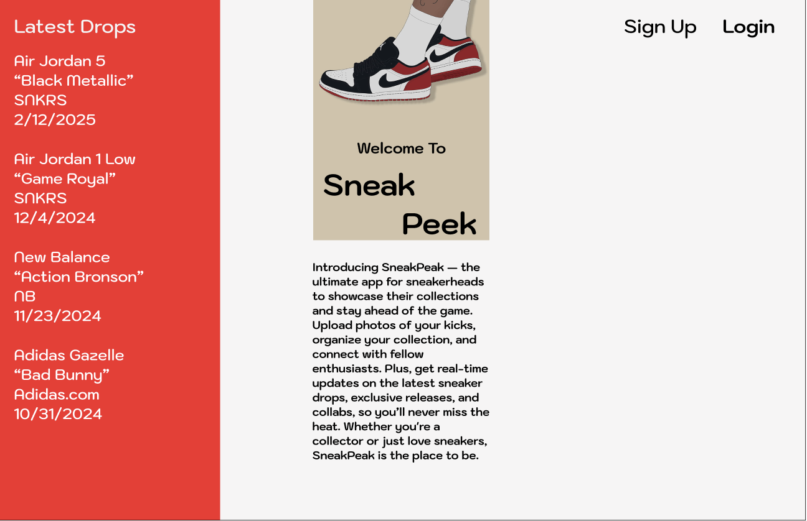
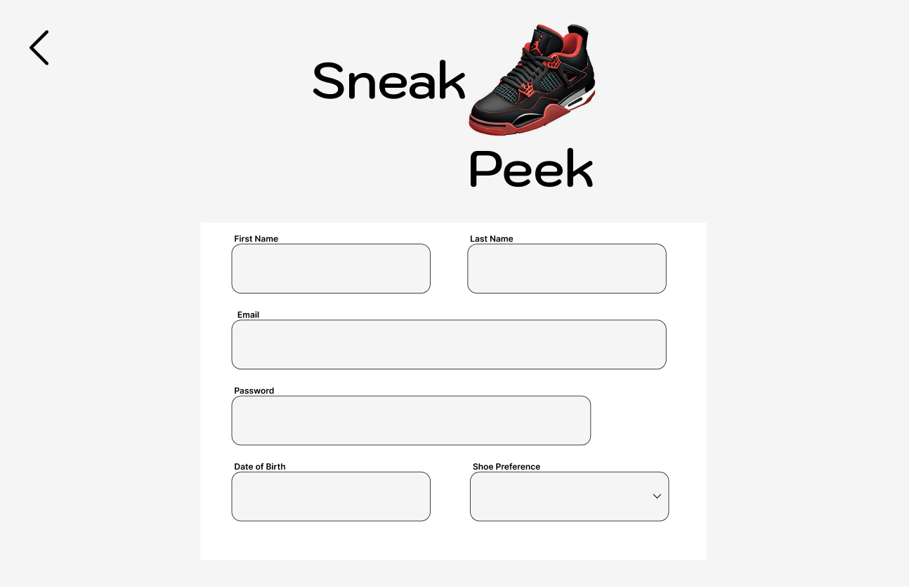
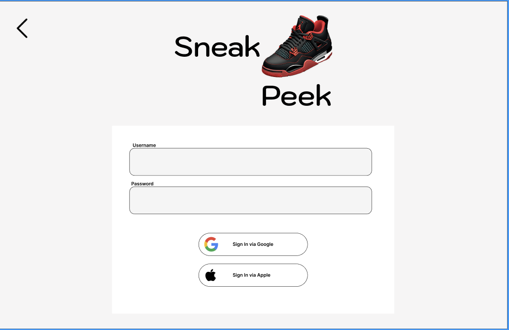
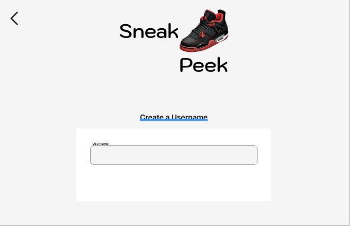
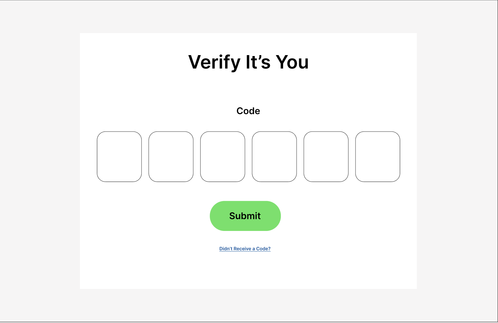
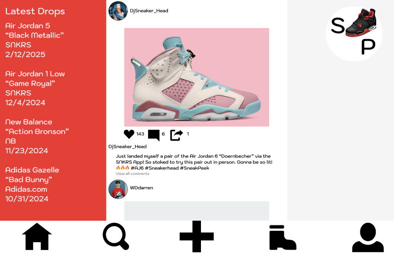
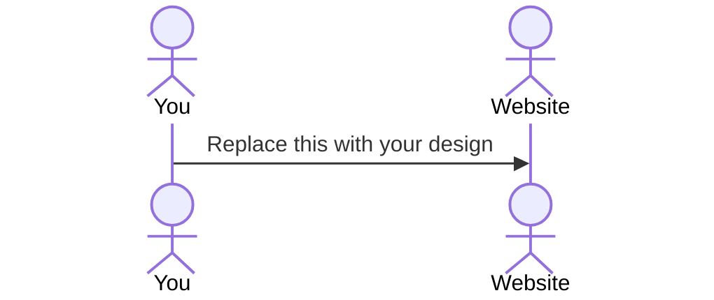

[My Notes](notes.md)

SneakPeak is a platform designed to unite sneakerheads and fashion enthusiasts by offering a space to share collections, discover new trends, and stay updated on the latest in sneaker culture. Users can create their own profiles, upload photos of their sneakers, and curate their collections in one place. Like Instagram, they can follow other accounts that post about the sneakers and styles they love, creating a personalized feed of the latest drops, fashion collaborations, and industry news. The app also serves as a hub for discovering upcoming releases and trends, ensuring users are always in the loop. SneakPeak is more than just a gallery — it's a community where sneakerheads can connect, share their passion, and stay at the forefront of the sneaker world.

**Live site:** [sneakpeek360.com](https://sneakpeek360.com) · **Everything added since the course deliverables:** see [Project update](#-project-update-features-and-changes) at the bottom of this file.

> [!NOTE]
> This is a template for your startup application. You must modify this `README.md` file for each phase of your development. You only need to fill in the section for each deliverable when that deliverable is submitted in Canvas. Without completing the section for a deliverable, the TA will not know what to look for when grading your submission. Feel free to add additional information to each deliverable description, but make sure you at least have the list of rubric items and a description of what you did for each item.

> [!NOTE]
> If you are not familiar with Markdown then you should review the [documentation](https://docs.github.com/en/get-started/writing-on-github/getting-started-with-writing-and-formatting-on-github/basic-writing-and-formatting-syntax) before continuing.

## 🚀 Specification Deliverable

> [!NOTE]
> Fill in this sections as the submission artifact for this deliverable. You can refer to this [example](https://github.com/webprogramming260/startup-example/blob/main/README.md) for inspiration.

For this deliverable I did the following. I checked the box `[x]` and added a description for things I completed.

- [x] Proper use of Markdown
- [x] A concise and compelling elevator pitch
- [x] Description of key features
- [x] Description of how you will use each technology
- [x] One or more rough sketches of your application. Images must be embedded in this file using Markdown image references.

### Elevator pitch

SneakPeak is the ultimate platform for sneakerheads and fashion lovers to connect, share, and stay updated on the latest trends. It’s like Instagram for sneaker enthusiasts, where users can upload their collections, follow accounts that match their style, and discover the newest sneaker drops and fashion collabs. With personalized feeds, real-time updates, and a thriving community, SneakPeak keeps you in the know and at the forefront of sneaker culture. It’s the go-to space to share your passion, track the heat, and never miss a release. Join the sneaker revolution with SneakPeak!

### Design

 <!-- index.html -->

 <!-- signUp.html -->

 <!-- loginPage.html -->

The design of SneakPeak is simple and intuitive, providing a seamless user experience from start to finish. Upon visiting the landing page, users are greeted with key features like upcoming shoe drops and popular posts from the community. Users can easily create an account or log in via Google authentication for quick and secure access. Once logged in, they are taken to their personalized account where they can follow other users, share photos of their sneaker collections, and even post fashion trends and tips. The design emphasizes ease of navigation, allowing users to engage with the app's core functionalities effortlessly while staying connected to the latest in sneaker culture.

### Key features

1. Personalized Sneaker Feed
   Users can follow their favorite sneaker brands, influencers, and other collectors to create a tailored feed of sneaker releases, collection highlights, and fashion trends. This feature keeps users engaged and ensures they only see the content they care about, from upcoming drops to exclusive collaborations.

2. Release Calendar & Alerts
   A built-in sneaker release calendar that shows upcoming drops, limited edition releases, and exclusive collaborations. Users can set alerts for specific sneakers, ensuring they never miss out on a release they’re interested in. This keeps the app both informative and action-driven, making it essential for any sneakerhead.

3. Virtual Sneaker Collection & Trading
   Allow users to upload photos of their sneakers and create a virtual "collection" they can showcase, track, and update over time. Additionally, integrating a safe and easy way to trade or sell sneakers within the community would create a marketplace aspect, giving users more reason to interact with the app.

### Technologies

I am going to use the required technologies in the following ways.

- **HTML**

  HTML will be used to structure the content of the app, including the layout of user profiles, sneaker collections, and the sneaker feed. It will define the basic elements like headings, images, and buttons, ensuring a solid foundation for the front-end interface.

- **CSS**

  CSS will be used to style the application, creating an attractive, user-friendly design. This will involve customizing fonts, colors, and layout grids to ensure a sleek, modern look that aligns with sneaker culture. Responsive design will be implemented so the app looks great on both mobile and desktop devices.

  I have added more CSS to make the web app look welcoming and fun. I am establishing a sense of culture with the sneaker community by developing an all inclusive site for sneakerheads worldwide to connect and share their collections and ideas in one place.

- **React**

  React will be used to build the interactive front-end of the app. It will manage the dynamic components, like the user feed, sneaker collections, and real-time updates for sneaker releases. React's component-based architecture will allow for efficient rendering and seamless user interactions.

- **Service**

  The service layer will handle business logic, such as fetching data from external APIs (e.g., sneaker release info, fashion trends) and managing real-time updates for users. It will facilitate communication between the front-end and back-end, ensuring smooth data flow and functionality across the app.

- **DB/Login**

  Users will log in using their email and a chosen password. Google Authentication will be integrated for enhanced security, allowing users to log in through their Google account. This will ensure safe, hassle-free authentication while protecting against unauthorized access and data breaches.

- **WebSocket**

  WebSocket will be used to enable real-time communication between the app and the server. This will be crucial for live updates on sneaker releases, notifications for new posts in the user feed, and any other dynamic content that requires immediate synchronization between the server and the client. WebSocket ensures a smooth, responsive experience with minimal delay.

## 🚀 AWS deliverable

For this deliverable I did the following. I checked the box `[x]` and added a description for things I completed.

- [x] **Server deployed and accessible with custom domain name** - [My server link](https://sneakpeek360.com).

## 🚀 HTML deliverable

For this deliverable I did the following. I checked the box `[x]` and added a description for things I completed.

- [x] **HTML pages** - I did complete this part of the deliverable.
- [x] **Proper HTML element usage** - I did complete this part of the deliverable.
- [x] **Links** - I did complete this part of the deliverable.
- [x] **Text** - I not complete this part of the deliverable.
- [x] **3rd party API placeholder** - I did complete this part of the deliverable.
- [x] **Images** - I did complete this part of the deliverable.
- [x] **Login placeholder** - I did complete this part of the deliverable.
- [x] **DB data placeholder** - I did complete this part of the deliverable.
- [x] **WebSocket placeholder** - I did complete this part of the deliverable.

## 🚀 CSS deliverable

For this deliverable I did the following. I checked the box `[x]` and added a description for things I completed.

- [x] **Header, footer, and main content body** - I did complete this part of the deliverable.
- [x] **Navigation elements** - I did complete this part of the deliverable.
- [x] **Responsive to window resizing** - I did complete this part of the deliverable.
- [x] **Application elements** - I did complete this part of the deliverable.
- [x] **Application text content** - I not complete this part of the deliverable.
- [x] **Application images** - I did complete this part of the deliverable.

## 🚀 React part 1: Routing deliverable

For this deliverable I did the following. I checked the box `[x]` and added a description for things I completed.

- [x] **Bundled using Vite** - I did complete this part of the deliverable.
- [x] **Components** - I did complete this part of the deliverable.
- [x] **Router** - Routing between login and voting components.

## 🚀 React part 2: Reactivity

For this deliverable I did the following. I checked the box `[x]` and added a description for things I completed.

- [x] **All functionality implemented or mocked out** - I did complete this part of the deliverable.
- [x] **Hooks** - I did complete this part of the deliverable.

## 🚀 Service deliverable

For this deliverable I did the following. I checked the box `[x]` and added a description for things I completed.

- [x] **Node.js/Express HTTP service** - I did complete this part of the deliverable.
- [x] **Static middleware for frontend** - I did complete this part of the deliverable.
- [x] **Calls to third party endpoints** - I did complete this part of the deliverable.
- [x] **Backend service endpoints** - I did not complete this part of the deliverable.
- [x] **Frontend calls service endpoints** - I did complete this part of the deliverable.

## 🚀 DB/Login deliverable

For this deliverable I did the following. I checked the box `[x]` and added a description for things I completed.

- [x] **User registration** - I did complete this part of the deliverable.
- [x] **User login and logout** - I did complete this part of the deliverable.
- [x] **Stores data in MongoDB** - I did complete this part of the deliverable.
- [x] **Stores credentials in MongoDB** - I did complete this part of the deliverable.
- [x] **Restricts functionality based on authentication** - I did complete this part of the deliverable.

## 🚀 WebSocket deliverable

For this deliverable I did the following. I checked the box `[x]` and added a description for things I completed.

- [x] **Backend listens for WebSocket connection** - I did complete this part of the deliverable.
- [x] **Frontend makes WebSocket connection** - I did complete this part of the deliverable.
- [x] **Data sent over WebSocket connection** - I did complete this part of the deliverable.
- [x] **WebSocket data displayed** - I did complete this part of the deliverable.
- [x] **Application is fully functional** - I did complete this part of the deliverable.

## 🚀 Project update: features and changes

Work done after the course deliverables. The sections above describe the original plan; this section describes what the app does now.

### What the app does today

- **Accounts and login** - one-page sign up (name, email, username, password, date of birth, shoe brand preferences) followed by required two-step login with an authenticator app.
- **Photo feed** - upload sneaker photos with a description, like posts, and comment on them. The feed shows your own posts plus posts from people you follow, and new posts appear live over WebSocket.
- **Profiles** - a centered profile page per user with profile picture, photo grid, and photo / follower / following counts. Users can change their own profile picture from their profile page.
- **Search** - find users by username (case-insensitive, best matches first).
- **Following and private accounts** - follow people; private accounts need to approve follow requests, and can remove existing followers. Private profiles are locked for non-followers.
- **Comments** - expand comments under any post, add one (300 characters), delete your own (post owners can delete any comment on their post).
- **Latest Drops** - sneaker lookup page backed by a third-party API (see [Known limitations](#known-limitations-and-next-steps)).
- **Responsive design** - near-black theme with a red accent, a phone layout, and an Instagram-style bottom tab bar (Feed, Drops, Search, Upload, Profile) on phones.

### Change log

**Profiles and photos**
- Added profile pages (`/profile/:username`) with a photo grid, reachable from usernames in the feed, the top nav and the phone tab bar.
- Profile pictures are uploaded to S3 and change everywhere, including on older posts and live in other users' feeds. Uploads accept JPEG, PNG, GIF and WebP up to 5 MB; the file type is checked from the file's contents, not its name. SVG and HEIC are not supported.
- Likes with live like counts; the server stores who liked a post but only sends the count and whether you liked it.
- Redesigned the upload page: drag-and-drop zone, photo preview, file info, description character counter, and Cancel / Upload buttons.
- Added a back arrow on the profile page and centered the profile layout and photo grid.

**Design**
- Replaced the textured background with a flat near-black theme and one red accent, driven by CSS variables in `src/styles.css`.
- Mobile layout: larger touch targets, 16px inputs (stops iOS zoom on focus), a bottom tab bar for logged-in users, and the old right-hand sidebar removed (Logout moved into the top nav).
- Restyled the sign up, login and MFA pages with a shared card layout, pill toggles for brand preferences, inline error messages, and buttons that disable while a request is running.

**Social features**
- User search (`/search`): `GET /api/users/search?q=`.
- Follow system with a `follows` collection (`pending` or `accepted`). Following a private account sends a request the owner accepts or declines on their profile. Owners can remove followers from a list that opens from their follower count. Switching an account to public approves everyone waiting.
- Privacy is enforced on the server, not just hidden in the UI: locked profiles never send their posts, the feed only includes you and accepted followings, and likes and comments on a private account's posts return 404 for non-followers.
- Live new-post messages are sent only to the author and their accepted followers. Each WebSocket connection is tied to its user from the login cookie, so unknown connections receive no posts.
- Comments with a `comments` collection, comment counts in the feed, and inline expand / add / delete.

**Sign up, login and security**
- Merged the old two-step sign up (details, then a separate username page that asked for the password again) into one form. Server-side validation: required fields, valid email, username 3-30 characters (letters, numbers, `.`, `_`), password of at least 8 characters. Usernames and emails are unique regardless of capitalization.
- **Required two-step login (TOTP):** after a correct password the server issues a short-lived challenge, not a login. The login cookie is only issued after a correct 6-digit code from an authenticator app (Google Authenticator, Authy, 1Password). First login or sign up shows a QR code to scan and 8 one-time recovery codes, shown once.
- MFA safeguards: a code can't be reused within its 30-second window; 5 wrong codes end a login attempt and 10 wrong codes lock code attempts for that account for 15 minutes; recovery codes work once and are stored only as SHA-256 hashes.
- **Authenticator secrets are encrypted at rest** with AES-256-GCM using `MFA_ENCRYPTION_KEY` from `service/dbConfig.json`; each secret is bound to its user's id, so copying it to another user's record doesn't work. The server refuses to start without a valid key. Secrets saved before encryption existed are encrypted automatically at startup.
- Fixed a login bug where any failure showed "Network error or server unavailable", and a bug where the login username was passed to the database without checking it was plain text.
- Removed logging of the sign up form (which included the password) from the browser console.

### Architecture

- **Frontend:** Vite, React 19, react-router-dom 7, Bootstrap CSS and react-bootstrap, axios. Source in `src/`; styles in `src/styles.css`.
- **Backend (`service/`):** Express 4 on port 4000 serving the built frontend and the `/api` routes, MongoDB driver, bcryptjs, cookie-parser, multer (memory storage), AWS SDK v3 for S3, `ws` for WebSocket, `otplib` and `qrcode` for MFA.
- **Database collections:** `users`, `posts`, `follows`, `comments`.
- **Login session:** an httpOnly, Secure, SameSite=Lax cookie holding a random token stored on the user's record.
- **Files:** `service/index.js` (routes), `service/uploadHandler.js` (S3 uploads and live updates), `service/mfa.js` (TOTP, recovery codes, encryption, lockouts), `service/feed.js` (post shaping), `service/api.js` (third-party sneaker proxy, port 4001).

### API reference

All routes are under `/api`. Everything except the `auth` routes requires a logged-in user.

| Area | Routes |
| --- | --- |
| Auth | `POST /auth/create`, `POST /auth/login`, `POST /auth/mfa/setup`, `POST /auth/mfa/verify-setup`, `POST /auth/mfa/verify`, `DELETE /auth/logout`, `GET /auth/me` |
| Posts | `GET /posts` (feed), `POST /upload` (image + description), `POST /posts/:id/like` |
| Comments | `GET /posts/:id/comments`, `POST /posts/:id/comments`, `DELETE /comments/:id` |
| Profiles | `GET /users/:username/posts`, `POST /upload/profile-picture`, `PUT /users/me/privacy` |
| Search | `GET /users/search?q=` |
| Following | `POST /users/:username/follow`, `DELETE /users/:username/follow`, `GET /follow-requests`, `POST /follow-requests/:username/accept`, `POST /follow-requests/:username/decline`, `GET /followers`, `DELETE /followers/:username` |

WebSocket (`/ws`) messages: `newPost` (author and accepted followers only), `likeUpdate` (post id and count), `profileUpdate` (new profile picture).

### Running it locally

1. `npm install` in the project root, and `npm install` in `service/`.
2. Create `service/dbConfig.json` (it is gitignored) with these keys: `MONGODB_URI`, `MONGODB_DB_NAME`, `AWS_REGION`, `AWS_ACCESS_KEY_ID`, `AWS_SECRET_ACCESS_KEY`, `S3_BUCKET_NAME`, `SNEAKERS_API_KEY`, and `MFA_ENCRYPTION_KEY`.
3. Generate the encryption key (64 hex characters) with `node -e "console.log(require('crypto').randomBytes(32).toString('hex'))"`. Keep it safe and never change it once users have set up MFA: a different key makes existing authenticator secrets unreadable.
4. Start the backend with `node index.js` from `service/`, and the frontend with `npm run dev` from the root (Vite proxies `/api` and `/ws` to the backend). The backend must be restarted to pick up server changes.

### Deploying

`./deployService.sh -k <pem key file> -h <hostname> -s <service>` builds the frontend, copies `service/*.js` and `service/*.json` (which includes `dbConfig.json`, so the encryption key goes with it), runs `npm install` on the server, and restarts the service with pm2. Pushing to GitHub does not update the live site.

### Known limitations and next steps

- **Latest Drops is broken in production.** The page calls `http://localhost:4001` (the separate `service/api.js` proxy to a RapidAPI sneaker API), which only works on a developer's machine. The API also lists current products rather than upcoming release dates. Plan: move to an `upcomingDrops` collection on the main server with a date-grouped calendar page.
- **Lost phone and recovery codes** means a manual reset: unset `mfaEnabled` (and the MFA fields) on that user in MongoDB, and they set up again at next login. There is no in-app way to turn MFA off or regenerate recovery codes yet.
- No rate limit on the password step (only MFA codes are limited).
- Image URLs in the S3 bucket are public, so a private account's photo is only hidden inside the app; anyone with the direct link can still open it. Real protection needs a private bucket with signed URLs.
- Like counts are broadcast to every connected browser (only a post id and a number); comments do not update live.
- Removing a follower and the follow-request flow have no notification badge.

### License

Copyright (c) 2025-2026 Steven Armstrong. All rights reserved. The code may not be copied, modified or reused without written permission, except for the portions that came from the BYU cs260 course template, which stay under the MIT License. See [LICENSE](LICENSE) for the full terms.
